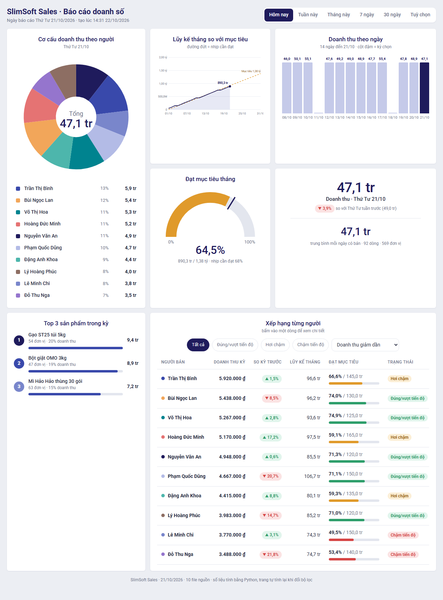
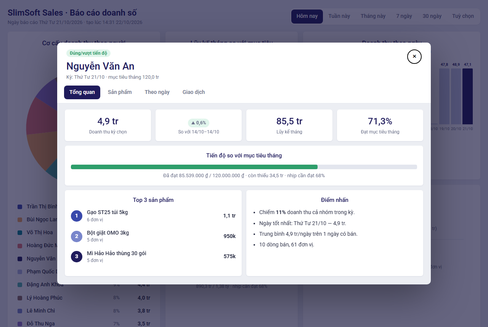
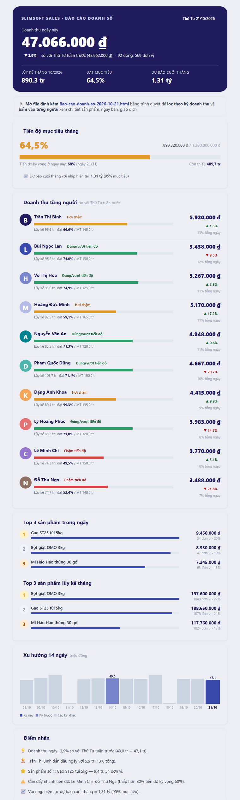

# Agent Báo cáo doanh số — skill `bao-cao-doanh-so` cho Claude Code và Codex

Agent đọc **file Excel doanh số của từng người** (cấu trúc khác nhau cũng được), tự nhận diện cột, gộp, tính, phát hiện bất thường, rồi gửi **báo cáo HTML tương tác + file Excel tổng hợp** qua Gmail và nhắn **nhóm Zalo**. Chạy tự động **hằng tuần (sáng thứ Hai, báo cáo tuần trước)** hoặc **hằng ngày (báo cáo ngày hôm trước)** trên đám mây, không cần mở máy (routine Claude Code hoặc GitHub Actions cho mọi agent).

Mọi con số do **Python** tính; Claude chỉ hỏi, lấy file, gửi thư/Zalo và đặt lịch. Dữ liệu bất thường **không bao giờ** được gửi cho nhóm: chỉ người phụ trách nhận cảnh báo riêng.

## Kết quả mẫu

**Báo cáo HTML tương tác** — lọc theo kỳ (ngày/tuần/tháng/7/30 ngày/tuỳ chọn), bấm vào từng người để xem chi tiết. Mở thử: [docs/mau-bao-cao.html](docs/mau-bao-cao.html).



**Chi tiết từng người** (bấm vào một dòng trong bảng xếp hạng): tổng quan, sản phẩm, theo ngày, giao dịch.



**Nội dung email** gửi kèm file HTML và Excel tổng hợp ([docs/mau-email.html](docs/mau-email.html), [docs/mau-tong-hop-doanh-so.xlsx](docs/mau-tong-hop-doanh-so.xlsx)).



*Dữ liệu trong ảnh là dữ liệu mẫu (10 người bán).*

## Quy trình agent làm với bạn

1. **Hỏi thông tin đầu vào:** file Excel hoặc **link Google Sheet của từng người** (mỗi Sheet một nhân viên, link cố định), link **Google Sheet tổng hợp** để ghi kết quả, email nhận báo cáo, nhóm Zalo, lịch chạy (ví dụ: *hằng tuần sáng thứ Hai 8h* hoặc *hằng ngày 8h T2–T6*).
2. **Tự phân tích:** nhận diện cột → gộp file → tính doanh thu kỳ, lũy kế tháng, đạt mục tiêu, so kỳ trước, top 3 sản phẩm, doanh thu từng người → kiểm tra bất thường → tạo báo cáo HTML (phong cách bảng điều khiển, có lọc kỳ và xem chi tiết từng người) + Excel tổng hợp.
3. **Gửi kết quả:** ghi bảng kết quả vào Google Sheet tổng hợp, email cho bạn (kèm HTML + Excel) và nhóm Zalo. Lịch hằng tuần gửi **tuần trước**; hằng ngày gửi **ngày trước**. Chạy tự động được khi tắt máy; nếu Zalo không gửi được trên môi trường tự động thì **bỏ qua Zalo**, xếp vào hàng đợi và **gửi bù khi bạn bật máy**.

## Google Sheet → chạy tự động hoàn toàn; Excel → nhắc cập nhật

| Bạn đưa cho agent | Điều xảy ra |
|---|---|
| **Link Google Sheet** của từng nhân viên (mỗi Sheet một người, link cố định) | **Chạy tự động theo lịch, không cần mở máy.** Đến giờ hẹn, agent trên đám mây tự vào từng Google Sheet xem số liệu từng nhân viên, tạo báo cáo (HTML + Excel) và gửi email. Nhân viên chỉ cần cập nhật số liệu vào Sheet trước giờ hẹn. |
| **File Excel** trên Drive | Giống Google Sheet: tự đọc theo lịch. Nhắc nhân viên **cập nhật số liệu vào đúng file đó** mỗi kỳ. |
| **File Excel chỉ nằm trên máy** | Agent **nhắc bạn** đưa file lên Google Drive (hoặc chuyển sang Google Sheets) và cập nhật số liệu ở đó — lịch đám mây không đọc được file trên máy. File trên máy chỉ dùng để chạy thử hoặc chạy khi máy bật. |

Thiếu số liệu của ai trong kỳ → báo cáo **không gửi nhóm**, chỉ cảnh báo người phụ trách; bật `staff_reminders` thì agent còn gửi **email nhắc đúng nhân viên đó** cập nhật số liệu (cc người phụ trách).

## Cài đặt

**Yêu cầu:** [Claude Code](https://claude.com/claude-code) **hoặc Codex**, Python 3.10+, tài khoản Google (Drive, Gmail), tài khoản Zalo (nếu gửi Zalo).

**Claude Code**

```bash
git clone https://github.com/slimsoftvietnam/agent-bao-cao-doanh-so ~/.claude/skills/bao-cao-doanh-so
pip install -r ~/.claude/skills/bao-cao-doanh-so/requirements.txt
```

**Codex** (thư mục skills của Codex; hoặc cấp dự án `<dự-án>/.agents/skills/bao-cao-doanh-so/`)

```bash
git clone https://github.com/slimsoftvietnam/agent-bao-cao-doanh-so "${CODEX_HOME:-$HOME/.codex}/skills/bao-cao-doanh-so"
pip install -r "${CODEX_HOME:-$HOME/.codex}/skills/bao-cao-doanh-so/requirements.txt"
```

Windows (PowerShell) — đổi `.claude` thành `.codex` nếu dùng Codex:

```powershell
git clone https://github.com/slimsoftvietnam/agent-bao-cao-doanh-so "$env:USERPROFILE\.claude\skills\bao-cao-doanh-so"
pip install -r "$env:USERPROFILE\.claude\skills\bao-cao-doanh-so\requirements.txt"
```

**Kết nối dịch vụ:** Claude Code bật connector **Gmail, Google Drive, Google Sheets** tại *claude.ai → Settings → Connectors*. Codex (hoặc khi không dùng connector): gửi email bằng SMTP (mật khẩu ứng dụng Gmail trong `GMAIL_USER`, `GMAIL_APP_PASSWORD`) và lấy file từ máy hoặc link Drive chia sẻ công khai.

## Sử dụng

Mở Claude Code hoặc Codex và gõ: `Thiết lập báo cáo doanh số` (Claude Code: `/bao-cao-doanh-so`; Codex: `$bao-cao-doanh-so`). Agent sẽ hỏi lần lượt như mục "Quy trình" ở trên, chạy thử cho bạn xem, rồi đặt lịch.

Sau đó: `Chạy báo cáo doanh số` (chạy thử, không gửi gì) · `Chạy báo cáo doanh số live` (gửi thật) · `Gửi Zalo tồn đọng`.

Hướng dẫn chi tiết (đặt lịch đám mây, Zalo, cảnh báo): [HUONG-DAN-SU-DUNG.md](HUONG-DAN-SU-DUNG.md). Quy trình agent làm theo: [SKILL.md](SKILL.md).

## Thử ngay không cần Google

```bash
cd ~/.claude/skills/bao-cao-doanh-so      # hoặc thư mục skill Codex của bạn
python scripts/run_report.py --inbox sample-data/inbox --date 2026-10-21            # báo cáo ngày, 10 người
python scripts/run_report.py --inbox sample-data/inbox-weekly --frequency weekly --today 2026-10-26   # báo cáo tuần trước
```

Mở `out/<ngày>/report.html` (bản tương tác) và file Excel `Tong-hop-doanh-so-*.xlsx`. Bản mẫu có sẵn trong [docs/](docs/).

## Đặt lịch chạy không cần mở máy

| Cách | Dùng khi | Ghi chú |
|---|---|---|
| **GitHub Actions** (mọi agent, kể cả Codex) | file nguồn là link Drive/Sheets chia sẻ công khai hoặc nằm trong repo | `python scripts/onboard.py make-workflow` → chạy hoàn toàn bằng Python (`scripts/auto_run.py`), không cần agent hay mở máy; email gửi qua SMTP kèm HTML + Excel |
| **Routine đám mây Claude Code** | file riêng tư trên Drive (dùng connector) | skill `schedule`, cron lấy từ `config/schedule.yaml` |

Cả hai cách đều cần repo **riêng tư** chứa config của bạn.

## Phát hiện bất thường (không gửi nhóm, chỉ báo người phụ trách)

Doanh thu lệch > 50% so với mốc (TB 4 tuần cùng thứ/cùng tuần) · dữ liệu trống · thiếu file · trùng file · sai cấu trúc hoặc file hỏng · người bán không có dòng nào trong kỳ · quá nhiều ô trống. Ngưỡng và mức độ chỉnh trong `config/alert_rules.yaml`.

## Cấu trúc

```
SKILL.md                 quy trình cho agent (thiết lập → chạy → Zalo tồn đọng), dùng cho Claude Code và Codex
agents/openai.yaml       tên hiển thị + lời nhắc gợi ý cho Codex
HUONG-DAN-SU-DUNG.md     hướng dẫn người dùng
config/                  sources.yaml · recipients.yaml · alert_rules.yaml · schedule.yaml (do onboard.py ghi)
scripts/                 run_report.py · onboard.py · auto_run.py (chạy không cần agent) · fetch_sources.py
                         send_mail.py · sheets_sync.py · zalo_queue.py · make_sample_data.py · selftest.py · sales_report/
references/              phong-cach-bao-cao.md (phong cách giao diện) · answers.example.json
sample-data/             inbox (ngày) · inbox-weekly (tuần): 10 người, 5 cấu trúc Excel + CSV
docs/                    bản mẫu báo cáo HTML, email, Excel, ảnh chụp
```

## Lưu ý

- **Google Sheet:** mỗi Sheet nhân viên được đọc qua link cố định (connector Google Sheets, hoặc tài khoản dịch vụ `GOOGLE_SERVICE_ACCOUNT_JSON` khi dùng Codex/GitHub Actions); kết quả ghi vào Sheet tổng hợp (tab Tổng quan, Theo người, Sản phẩm, Theo ngày, Lịch sử). Xem [HUONG-DAN-SU-DUNG.md](HUONG-DAN-SU-DUNG.md).
- Config chứa email của bạn: muốn lịch chạy trên đám mây thì đẩy config lên **repo riêng tư** của bạn (không dùng bản công khai này).
- Zalo không có API công khai cho nhóm cá nhân nên gửi qua trình duyệt; trên môi trường tự động thường không gửi được (không có Zalo Web đăng nhập) — đó là lý do có hàng đợi Zalo.
- Muốn đính kèm HTML + Excel trong email tự động, cần mật khẩu ứng dụng Gmail (`GMAIL_USER`, `GMAIL_APP_PASSWORD`); không có thì (Claude Code) thư gửi bản rút gọn qua connector và không đính kèm.
- File nguồn riêng tư trên Drive chỉ đọc được qua connector Drive của agent; GitHub Actions và `fetch_sources.py` chỉ tải được link chia sẻ công khai.

Phát hành bởi SlimSoft · Khóa học AI Agent SlimAI.
